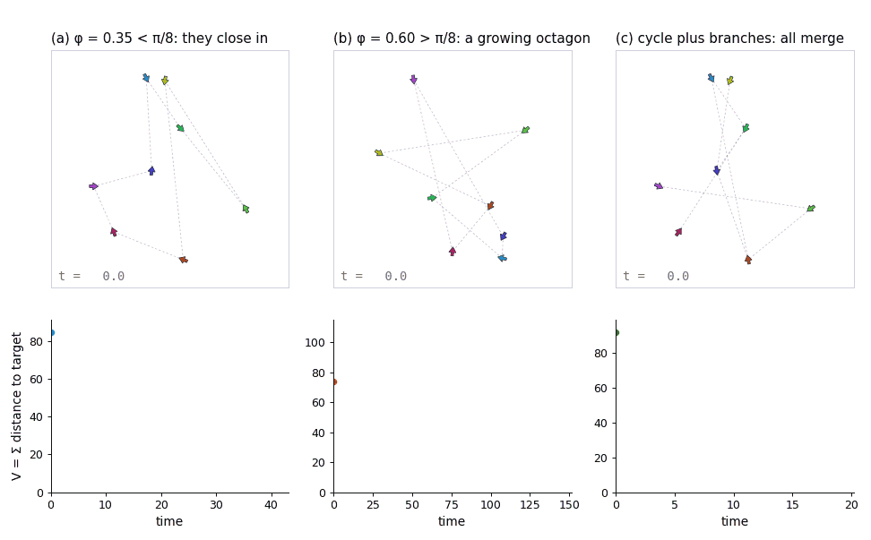
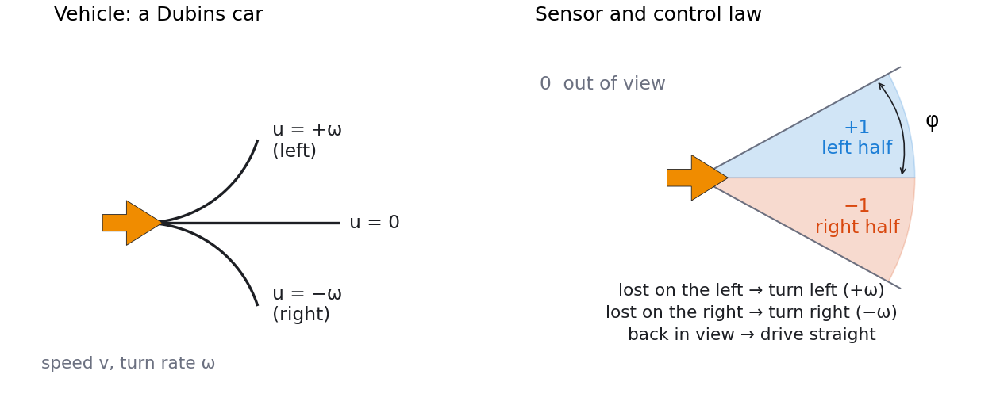
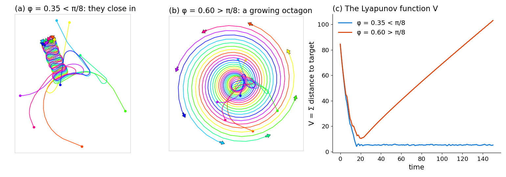

# Rendezvous without Coordinates

Robots that only know which side of their windshield their target slipped out of, and
still all meet.

[](https://ru-arcl.github.io/rendezvous-without-coordinates/)

*Top: the agents; bottom: V, the sum of distances to targets. (a) Eight agents with
φ = 0.35 < π/8 close in. (b) With φ = 0.60 > π/8 they form an octagon that keeps growing.
(c) A cycle with branches and merging radius ρ = 0.3 collapses to a single agent.*

**[Live demo](https://ru-arcl.github.io/rendezvous-without-coordinates/)**: runs in the browser with no install. It also opens from `docs/index.html` on disk.

## The idea

Each agent is a Dubins car: it drives forward at a fixed speed and can only go straight,
turn left or turn right at a fixed rate ω. Its sensor reports one of three things about its
assigned target: in the left half of the windshield, in the right half, or out of view. There
are no distances, angles, coordinates, communication or state estimation. The control law is
just as small: when the target slips out on the left, turn left; on the right, turn right;
when it is back in view, drive straight.



We showed that this is enough for rendezvous. The sum of distances from every agent to its
target, V, is a Lyapunov function. For a pursuit cycle of n agents it is guaranteed to
decrease when the windshield half-angle φ is small enough (π/n for n ≥ 5). Above π/n, a
regular polygon of agents can expand forever. Agents that come within a merging radius ρ of
their target merge, and the argument extends to trees, to cycles with branches, to bounded
and differing speeds, and, with reassignment, to agents that start with no target at all.



*(a, b) The same eight agents with φ = 0.35 < π/8 and φ = 0.60 > π/8 (the setup of Fig. 6 in
the paper). (c) V over time for both runs.*

We have made some minor corrections to the IEEE TAC publication; the
[updated manuscript](updated/rendezvous-without-coordinates-updated.pdf) is available here.

## What's here

| Path | What it is |
| --- | --- |
| `src/rwc/` | Python package: simulator (`sim`), scenarios, Lyapunov function, the paper's bounds (`bounds`), a numerical oracle that maximizes V̇ over all geometries (`oracle`), and a live viewer |
| `docs/index.html` | The browser demo. Vanilla JS, no build step, works from `file://` |
| `docs/js/rwc-engine.js` | The same engine in JavaScript, held to the Python one by parity fixtures |
| `updated/` | [The updated manuscript](updated/rendezvous-without-coordinates-updated.pdf) (PDF) |
| `docs/notes/` | Notes on the corrections, with reproductions |
| `docs/DESIGN.md` | The exact step order both engines implement |
| `tests/` | Paper examples, checks of the corrections, oracle checks, parity |

## Quick start

```bash
pip install -e ".[test,viewer]"
pytest                                   # Python tests (~10 s)
npm test                                 # JavaScript engine vs. Python (Node >= 22)
python -m rwc.viewer                     # live viewer: every agent ends up following your mouse
```

```python
from rwc import make_sim

sim = make_sim("cycle", n=8, seed=1, phi=0.35, omega=2.0, dt=0.1, rho=1e-3)
V0 = sim.V()
sim.run(2000)
print(f"V: {V0:.1f} -> {sim.V():.1f}")   # V: 84.5 -> 5.6  (phi < pi/8: they close in)

# rho ~ 0 above turns merging off, so they keep circling in a small cluster, as in Fig. 6(a).
# With a merging radius and a fast enough turn (omega > 2/rho) they become one agent:
sim = make_sim("cycle", n=8, seed=1, phi=0.35, omega=8.0, dt=0.1, rho=0.3)
sim.run(2000)
print(sim.n_alive(), round(sim.t, 1))   # 1 27.3
```

```python
from rwc import bounds

bounds.thm4_phi(8)        # 0.3927  Theorem 4, eq. (11), as printed
bounds.critical_phi(3)    # 1.0472  the exact threshold pi/n (eq. (11) gives 0.8411 for n = 3)
bounds.tracking_omega(1.0, 0.3, 0.35)   # 4.48  turn rate that keeps the target in view (Prop. 16)
```

The figures regenerate with `python docs/media/make_figures.py` and the GIF with
`python docs/media/make_demo_gif.py` (needs ffmpeg).

## Citation

```bibtex
@article{YuLavLib12,
  author  = {Yu, Jingjin and LaValle, Steven M. and Liberzon, Daniel},
  title   = {Rendezvous Without Coordinates},
  journal = {IEEE Transactions on Automatic Control},
  volume  = {57},
  number  = {2},
  pages   = {421--434},
  year    = {2012},
  doi     = {10.1109/TAC.2011.2158172}
}

@inproceedings{YuLavLib08,
  author    = {Yu, Jingjin and LaValle, Steven M. and Liberzon, Daniel},
  title     = {Rendezvous Without Coordinates},
  booktitle = {Proceedings of the 47th IEEE Conference on Decision and Control},
  pages     = {1803--1808},
  year      = {2008},
  doi       = {10.1109/CDC.2008.4739343}
}
```

## License

The code is under the BSD 3-Clause license; see [LICENSE](LICENSE). The updated paper in
`updated/` is not covered by that license: it is our updated version of an article © 2012 IEEE,
posted under IEEE's author-posting terms (see the notice on its first page).
