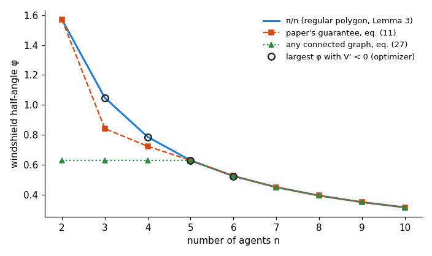

# Windshield bounds: what is tight and what is loose

**Summary.** Our main windshield results are correct as sufficient conditions, but several
are conservative. For unit-speed pursuit the exact threshold is **φ < π/n**: the
regular-polygon bound of Lemma 3. We found this numerically for every n we tried (2…12) and
every connected single-target graph, and we have an analytic argument for cycles. It is better
than eq. (11) for n = 3, 4 and better than eq. (27) for n ≤ 4.
Two proof steps are wrong; neither breaks a theorem.

Reproduce: `pytest tests/test_errata.py tests/test_oracle.py`, and
`python docs/media/make_figures.py` for the figure below.

## Theorem 4, eq. (11): conservative for n = 3, 4

Eq. (11) gives `arccos((n−1)/n)` for n = 3, 4 (0.8411 and 0.7227). The true threshold is π/n
(1.0472 and 0.7854). The `n − 1` bound on the Θ_o slice in Lemma 7 is the loose step. For
example, at n = 3 and φ = arccos(2/3), sup f = 0.936 against the bound 2 (offline computation).

How we know:

* We maximized V̇ directly from positions and headings, not from the θ/φ formula, with every
  target strictly inside the windshield. We used L-BFGS from many starts and bisected on φ
  (`rwc.oracle.critical_phi`).
  * Result: φ* = π/n to within 10⁻⁵ for n = 2…10, for simple and self-intersecting polygons.
* Analytic argument:
  * Agent i contributes at most `cos(α_i − φ) − cos φ`, where α_i is the unsigned turning angle
    at vertex i.
  * The turning angles of a closed polygon satisfy Σα_i ≥ 2π.
  * A tangent-line argument then gives sup V̇ = n(cos(2π/n − φ) − cos φ) near the threshold.
    This is the regular n-gon of Lemma 3.

So for cycles, the bound of CDC 2008 eq. (10), min{π/n, arccos((n−1)/n)}, is exact for n ≥ 5
and conservative for n = 2, 3, 4.

## Corollary 9 needs a strict inequality

Eq. (11) is written `0 < φ ≤ …`. At equality (φ = π/n for n ≥ 5, φ = π/2 for n = 2) each
configuration still has V̇ < 0, because the windshield is open. But sup V̇ = 0:

* a regular n-gon with bearings π/n − ε has V̇ ≈ −2n sin(π/n) ε;
* so no δ_φ > 0 gives V̇ < −δ_φ;
* so the finite-time argument of Corollary 9 does not apply.

For n = 3, 4 equality is harmless (sup V̇ = −1.064 and −0.354). The CDC version uses `<`, which
is the fix.

## Theorem 12, eq. (27): the π/5 cap is unnecessary, and one proof step is false

The proof says: "When k = 2, 3, 4, V̇_k is less than −1 by direct computation." For k = 4 this
is false. Take a square whose agents all see their targets at bearing → π/5:

    V̇_4 = 4 (sin 36° − cos 36°) = −0.8849 > −1.

The direct maximum over all quadrilaterals is the same −0.8849. The claim holds only for
φ < 34.82°. The theorem survives anyway:

* the k = 4 gap only matters for n = 5;
* there, sup V̇ = −0.8849 + (1 − cos 36°) = −0.694 < 0.

The stronger fact is this:

* For a k-cycle with n − k branch agents, sup V̇ = S_k(φ) + (n − k)(1 − cos φ), where S_k is
  the cycle's sup.
  * Every branch agent can sit directly behind its target's velocity.
  * We confirmed this by direct optimization on cycle-plus-branch geometries.
* Evaluating this for n = 2…12 gives the exact threshold **π/n**, always set by the pure cycle
  k = n. Branches never bind.
* So (27) can be replaced by φ < π/n. It is conservative for n = 2, 3, 4 (π/5 instead of π/2,
  π/3 and π/4).

Smaller slip: in eq. (28) both sums run over i = 0…k (k + 1 terms) but evaluate to k times
the summand. The index should be i = 1…k.

## Theorem 13, eq. (32): very conservative

Eq. (32) is sufficient. We checked by maximizing V̇ over positions, bearings and speeds in
[v_min, v_max] at 0.999× the bound; the sup was always negative. But it reaches only 14–56% of
the true critical angle:

| n | v_min/v_max | eq. (32) | true critical φ |
|---|---|---|---|
| 3 | 1.0 | 0.586 | 1.047 (π/3) |
| 4 | 0.5 | 0.271 | 0.756 |
| 8 | 0.25 | 0.069 | 0.347 |
| 10 | 0.1 | 0.031 | 0.227 |

The true values come from an exact reduction to turning angles, confirmed by direct geometry at
±0.1% (offline). `tests/test_oracle.py` brackets the n = 4 entry at ±2%.

## Lemma 11 is tight; bounded-speed intrees do have a guarantee

Lemma 11, φ < arccos((n−2)/(n−1)), is exact. The worst case is the star
root ← k ← (n − 2 leaves): every leaf sits directly behind k's velocity and sees k at bearing → φ.

Section V says (p. 428) that "no equivalent of Lemma 11 can be stated" for bounded speeds. That
is too strong. Over speeds in [v_min, v_max] the same star is the worst case:

    sup V̇ = (n − 2 − cos φ) v_max − (n − 2) cos φ v_min,

So V̇ < 0 is guaranteed iff cos φ > (n − 2) v_max / (v_max + (n − 2) v_min). Such a φ exists
iff v_max/v_min < (n − 2)/(n − 3). The Fig. 5 example needs v_max/v_min ≥ 2 for n = 4. This is
`rwc.bounds.intree_phi`.

## Small things that check out

* **Lemma 5's side note** ("the Θ_i slice may be empty when n ≤ 5") is correct and tight. The
  slice is empty iff Σφ_i < (4 − n)π/2, which can happen only for n ≤ 5 since Σφ_i > −π.
* **Fig. 9's corner labels** lack minus signs. By (15) the n = 3 box is (−π/3, 2π + π/3)³, and
  the drawing is consistent with that box.
* **CDC Lemma 3** says φ = π/n "permits V̇ = 0". With an open windshield this needs φ > π/n,
  which is how TAC Lemma 3 states it.
